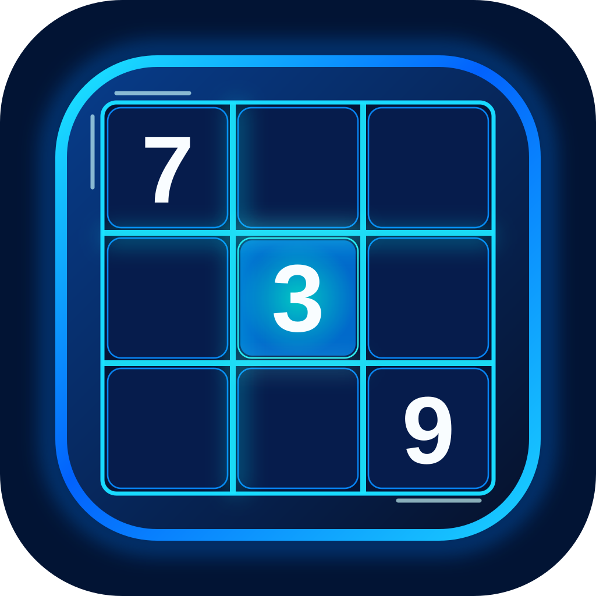
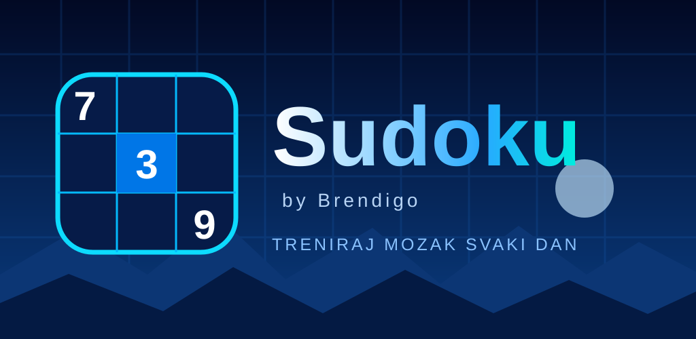
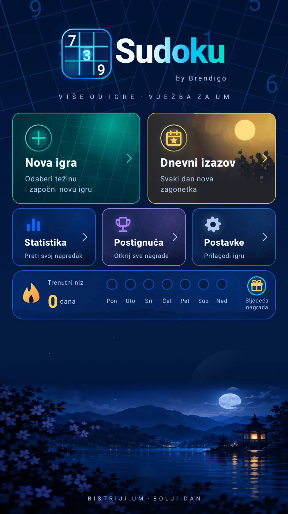
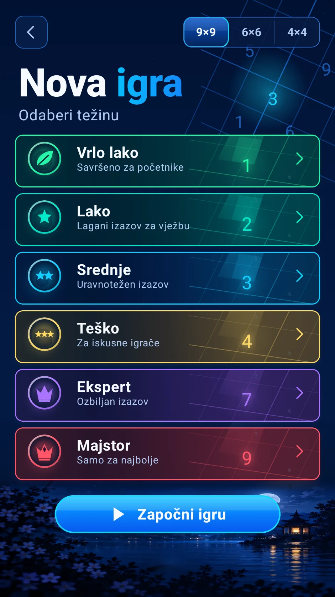
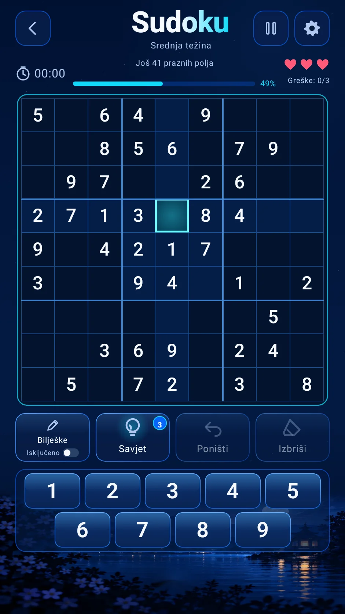
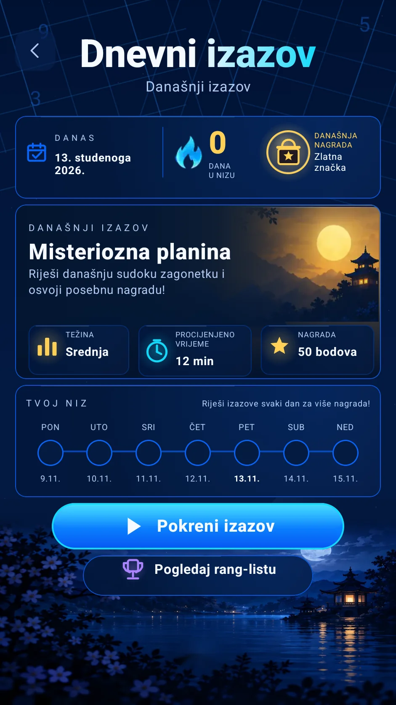
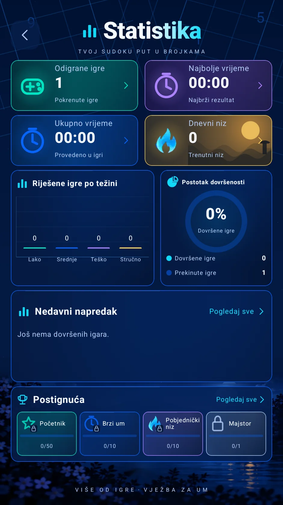
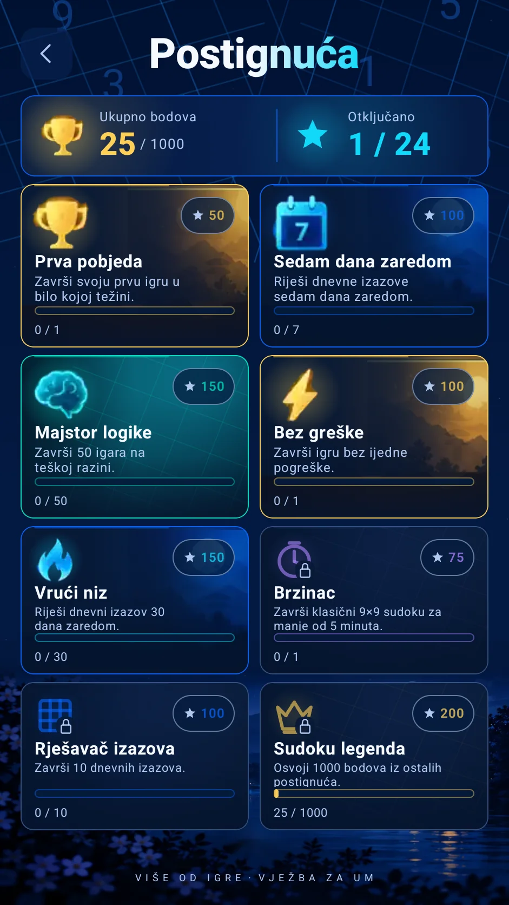
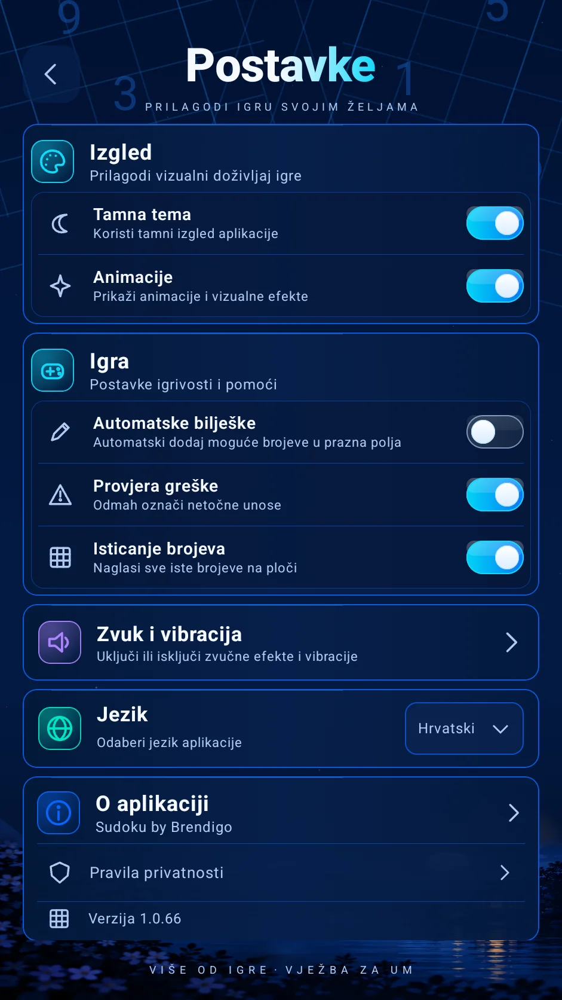
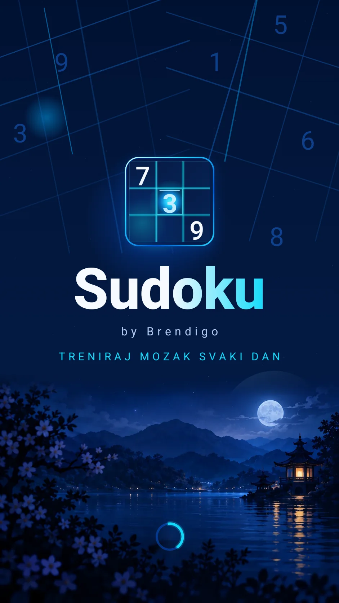

### Svaki dan novi izazov. Svaki potez vrijedi.

**Sudoku kakav zaslužuje tvoj Android — pregledan, elegantan i potpuno offline.**

🧩 **3 veličine ploče** &nbsp;·&nbsp; ⚡ **6 težina** &nbsp;·&nbsp; 🗓️ **Dnevni izazovi** &nbsp;·&nbsp; 🏆 **24 postignuća**

[**⬇️ GitHub izdanja**](https://github.com/bren-wp/Sudoku/releases) &nbsp;·&nbsp;
[**▶️ Google Play**](https://play.google.com/store/apps/details?id=com.brendigo.sudoku) &nbsp;·&nbsp;
[**📱 Pogledaj aplikaciju**](#-stvarni-zasloni-aplikacije) &nbsp;·&nbsp;
[**🌐 Brendigo**](https://brendigo.com)

&nbsp;&nbsp;

---

## ✨ Logika nikada nije izgledala ovako dobro

Spoj klasične Sudoku igre, modernog tamnoplavog dizajna i pažljivo oblikovanih neonskih detalja. Igraj brzo u slobodnoj minuti ili posveti više vremena težoj zagonetki — **bez oglasa, registracije i internetske veze**.

| 🧩 **Igra po tvojoj mjeri** | 🌙 **Dnevni ritual** | 🏆 **Napredak koji se vidi** |
| :--- | :--- | :--- |
| 4×4, 6×6 ili klasični 9×9 Sudoku. Šest težina od *Vrlo lako* do *Majstor*. | Svaki dan zaseban izazov, kalendar, dnevni niz i lokalna rang-lista. | Statistika, povijest partija, bodovi i 24 postignuća. |

## 📱 Stvarni zasloni aplikacije

Ovo su **stvarne snimke Android aplikacije**, snimljene na emulatoru pri **941 × 1672 px** i pohranjene u repozitoriju kao optimizirane WebP datoteke. Nisu koncepti, AI-generirane slike ni statične zamjene za funkcionalne zaslone. Prikazuju stanje aplikacije tijekom testiranja; tvoji datumi i rezultati ovise o vlastitom napretku.

<table align="center">
  <tr><th>Početna</th><th>Nova igra</th><th>Sudoku partija</th></tr>
  <tr>
    <td></td>
    <td></td>
    <td></td>
  </tr>
  <tr><th>Dnevni izazov</th><th>Statistika</th><th>Postignuća</th></tr>
  <tr>
    <td></td>
    <td></td>
    <td></td>
  </tr>
  <tr><th>Postavke</th><th>Splash zaslon</th><th>Ikonica aplikacije</th></tr>
  <tr>
    <td></td>
    <td></td>
    <td align="center"></td>
  </tr>
</table>

## 🎯 Sve što trebaš za odličnu partiju

- **🔢 Tri Sudoku formata** — 4×4 za prve korake, 6×6 za kraću vježbu i 9×9 za klasično iskustvo.
- **🧠 Šest razina** — Vrlo lako, Lako, Srednje, Teško, Ekspert i Majstor.
- **✍️ Praktični alati** — bilješke, savjeti, brisanje, poništavanje, isticanje brojeva i provjera pogrešaka.
- **⏸️ Nastavi gdje si stao** — lokalno spremljen napredak i povratak u započetu igru.
- **📅 Dnevni izazovi** — kalendar, niz riješenih dana, nagrade i osobni rezultati.
- **📊 Detaljna statistika** — odigrane igre, vrijeme, postotak dovršenosti i povijest.
- **🏆 24 postignuća** — stvarni ciljevi i bodovi, bez izmišljenog napretka.
- **🔒 Kontrola nad podacima** — lokalna pohrana i opcionalni šifrirani izvoz/uvoz napretka.

## 🚀 Novo u Sudoku v1.0.70

- **Zaštićeno pokretanje partija** — dva brza dodira na „Nova igra” ili „Dnevni izazov” više ne mogu istodobno zamijeniti istu partiju dok traje spremanje na disk.
- **Sigurniji povratak u igru** — najnoviji potezi aktivne klasične partije čuvaju se u memoriji i ne zamjenjuju se starijim spremanjem iz pozadinskog reda.
- **Bez ponovnog otvaranja dovršene igre** — odigrana partija se ne nudi kao nedovršena ako njezin posljednji zapis na disk još traje.
- **Manje nepotrebnog čekanja** — uklonjena je suvišna diskovna kontrolna točka pri povratku u postojeći dnevni izazov.
- **Dodatna Android regresijska zaštita** — testni kod namjerno blokira zapis na disk i provjerava četiri kritična slučaja, uključujući statistiku, završetak partije i obnovu podataka.

[Detaljan tehnički i sigurnosni pregled v1.0.70](docs/gameplay-transition-audit-v1.0.70.md). Izgled zaslona nije promijenjen; 1:1 usklađenost svih izvornika još nije dokazana.

## 📦 Instalacija i izdanje

**[Otvori aplikaciju na Google Playu](https://play.google.com/store/apps/details?id=com.brendigo.sudoku)** ili **[preuzmi testni APK s GitHub Releases](https://github.com/bren-wp/Sudoku/releases)**. Google Play poveznica vodi na identifikator paketa `com.brendigo.sudoku`; dostupnost aplikacije ovisi o zemlji, računu i statusu objave. Testni APK iz GitHuba može se instalirati na podržani Android uz dopuštenje za instalaciju iz odabranog izvora.

| Zahtjev | Vrijednost |
| :--- | :--- |
| Sustav | Android 8.0 (API 26) ili noviji |
| Identitet aplikacije | <code>com.brendigo.sudoku</code> |
| Jezik sučelja | Hrvatski |
| Internet | Nije potreban |
| Oglasi / praćenje | Nema oglasnih ni analitičkih SDK-ova |
| Izdavač | **BRENDIGO** · [brendigo.com](https://brendigo.com) |

**Važno o potpisivanju:** Ako GitHub izdanje sadrži datoteke označene <code>-test.apk</code> i <code>-unsigned.aab</code>, to je **testno izdanje (prerelease)**. Takav AAB nije potpisan za objavu na Google Playu. Za produkcijsku nadogradnju potreban je odgovarajući postojeći izdavački ključ.

## 🔐 Privatnost bez kompromisa

Sudoku radi lokalno, bez prijave, oglasa, obveznog računa ili pristupa internetu. Postavke, rezultati i partije ostaju na uređaju. Po želji možeš izvesti napredak u lozinkom zaštićenu datoteku i kasnije ga vratiti uz pregled podataka prije zamjene postojećeg stanja. **Čuvaj lozinku — ne postoji internetski servis za njezin oporavak.**

[Pročitaj pravila privatnosti](PRIVACY.md).

## 🎨 Dizajn i kvaliteta

Sučelje je izrađeno nativnim Android/Jetpack Compose komponentama, a galerija prikazuje stvarne emulatorske snimke zaslona. Izvorne korisnikove dizajnerske reference služe za daljnje pixel-by-pixel provjere. **Potpuna 1:1 podudarnost još nije potvrđena**, a rezultati mjerenja javno su dokumentirani u [pixel-QA izvještaju](docs/pixel-qa-v1.0.64.md).

Za tehničke upute i provjere kvalitete pogledaj [razvojnu dokumentaciju](docs/DEVELOPMENT.md) i [povijest izmjena](CHANGELOG.md).

---

**Sudoku by BRENDIGO**

*Bistriji um. Bolji dan.*

[🌐 brendigo.com](https://brendigo.com) · [▶️ Google Play](https://play.google.com/store/apps/details?id=com.brendigo.sudoku) · [📦 Izdanja](https://github.com/bren-wp/Sudoku/releases) · [🛡️ Privatnost](PRIVACY.md) · [📋 Licencija](LICENSE)

