

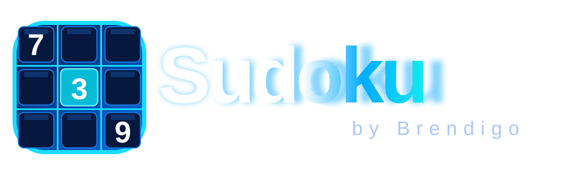

### Više od igre. Vježba za um.

**Premium Sudoku za Android • Na hrvatskom • Bez interneta • Bez oglasa**

**Izdanje 1.0.46** · Android 8.0+ · Bez oglasa · Bez interneta

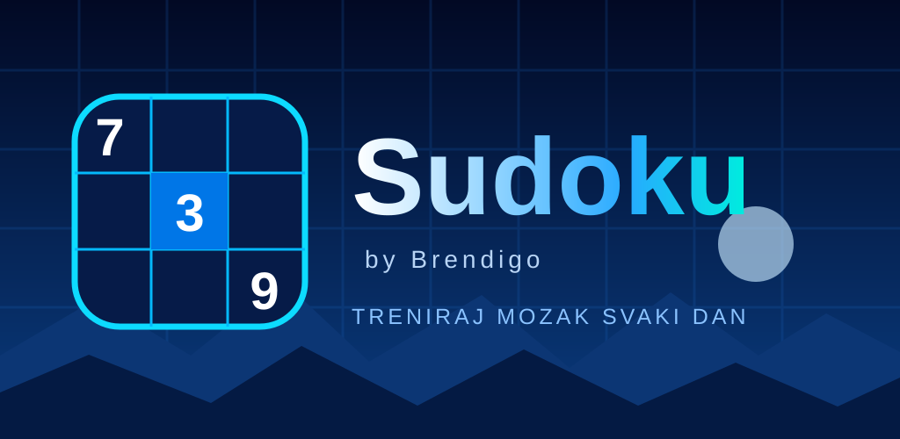

 

<a href="https://github.com/bren-wp/Sudoku/releases"><strong>Preuzmi najnovije izdanje</strong></a>
&nbsp;·&nbsp;
<a href="#-snimke-aplikacije">Pogledaj svih 8 ekrana</a>
&nbsp;·&nbsp;
<a href="#-što-sudoku-nudi">Mogućnosti</a>
&nbsp;·&nbsp;
<a href="#-preuzimanje-i-instalacija">Preuzimanje</a>

---

## 🧩 Sudoku by Brendigo

Upoznaj klasičnu logičku igru u suvremenom neonsko-plavom izdanju.
**Sudoku** kombinira 4×4, 6×6 i 9×9 mreže, šest razina, dnevne izazove,
napredak i postignuća — sve lokalno na uređaju, bez registracije.

<table>
<tr>
<td width="28%" align="center">
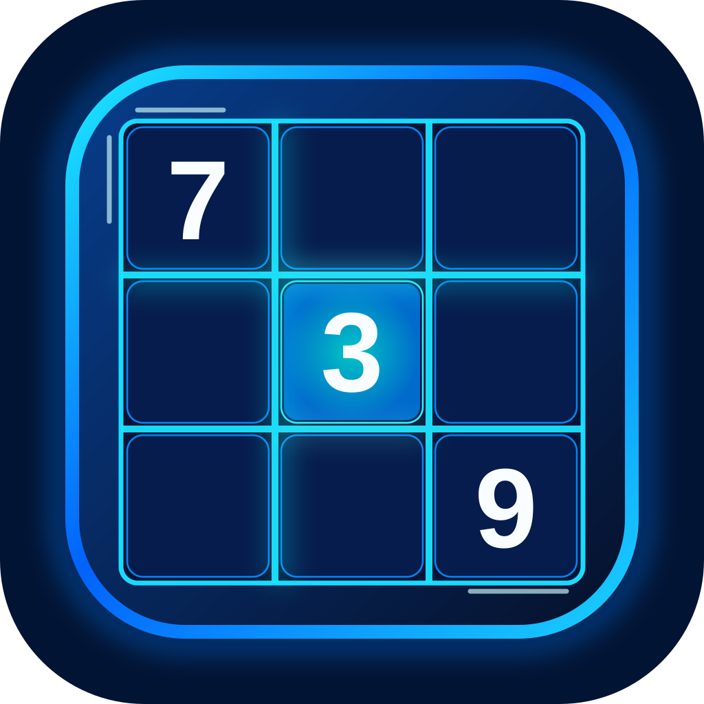
 <strong>Originalan 7–3–9 vizualni identitet</strong>
</td>
<td>

**Zašto igrati?**

- 🔹 **Tri veličine mreže** — 4×4, 6×6 i 9×9.
- ⚡ **Šest razina** — od Vrlo lako do Majstor.
- 🗓️ **Dnevni izazovi** — jedinstvena zagonetka za svaki datum.
- 🏆 **24 postignuća** — stvarne nagrade i praćenje napretka.
- 🧠 **Pomoć pri učenju** — bilješke, savjeti, poništavanje, označavanje brojeva.
- 🔒 **Privatnost** — bez računa, oglasa, praćenja i internetske dozvole.

</td>
</tr>
</table>

## 📱 Snimke aplikacije

U galeriji su **stvarne snimke osam zaslona, uključujući splash** iz Android emulatora
(941 × 1672 px), optimizirane u WebP format bez zamjene interaktivnog sučelja
statičnim slikama. Snimke prikazuju testno stanje aplikacije, a ne izmišljene
korisničke rezultate. Izvor su provjerljivi instrumentacijski testovi i
[workflow za stvarne snimke](.github/workflows/marketing-screenshots.yml).

Originalne referentne ilustracije, uključujući splash, logotip i ikonu, ostaju
cilj daljnje **1:1** usklađenosti. Prolazak testova ne znači da je pikselna
jednakost svih ekrana već potvrđena.

<table align="center">
<tr><th>Početni ekran</th><th>Nova igra</th><th>Sudoku ploča</th></tr>
<tr>
<td><a href="docs/screenshots/01-home.webp">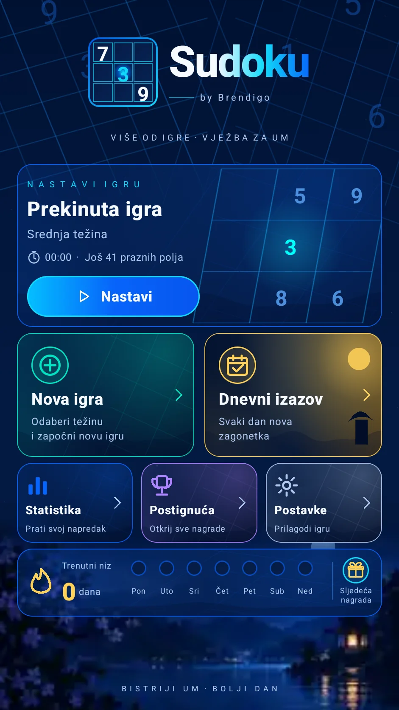</a></td>
<td><a href="docs/screenshots/02-new-game.webp">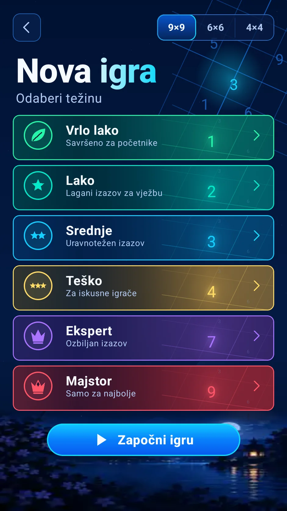</a></td>
<td><a href="docs/screenshots/03-game.webp">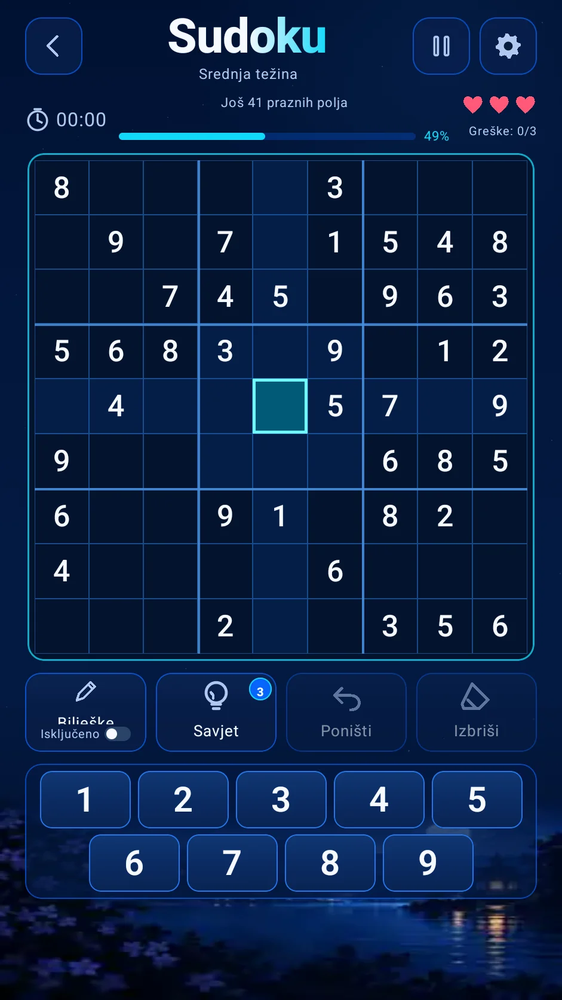</a></td>
</tr>
<tr><th>Dnevni izazov</th><th>Statistika</th><th>Postignuća</th></tr>
<tr>
<td><a href="docs/screenshots/05-daily.webp">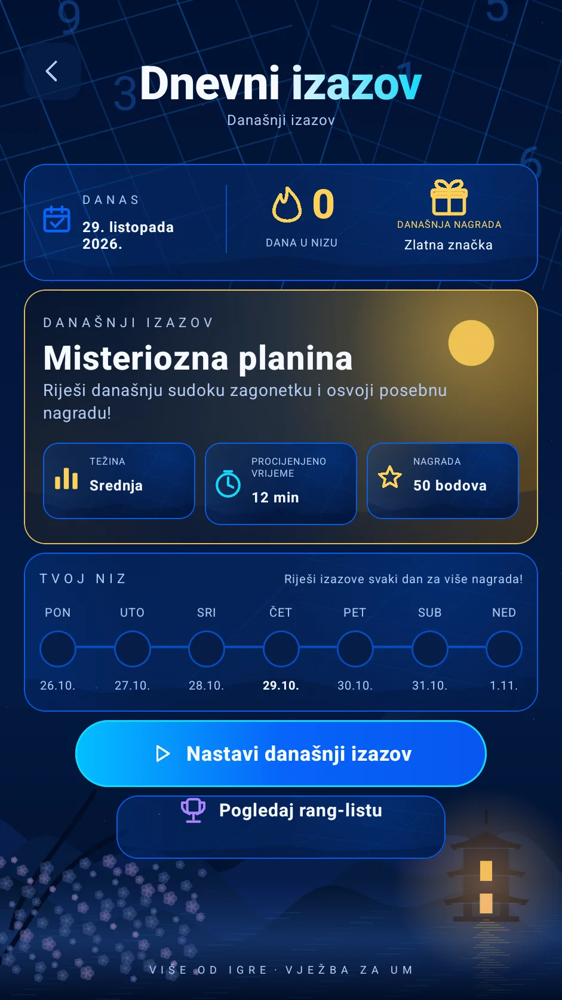</a></td>
<td><a href="docs/screenshots/06-statistics.webp">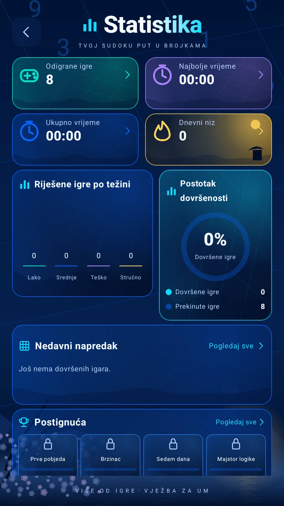</a></td>
<td><a href="docs/screenshots/07-achievements.webp">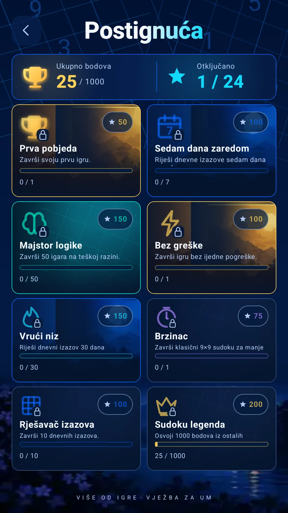</a></td>
</tr>
<tr><th colspan="2">Postavke</th><th>Početni splash</th></tr>
<tr>
<td colspan="2" align="center"><a href="docs/screenshots/04-settings.webp">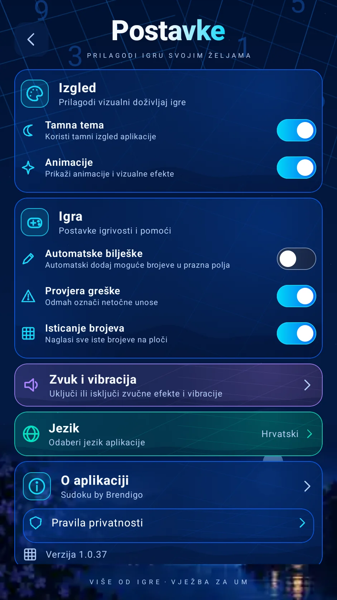</a></td>
<td align="center"><a href="docs/screenshots/08-splash.webp">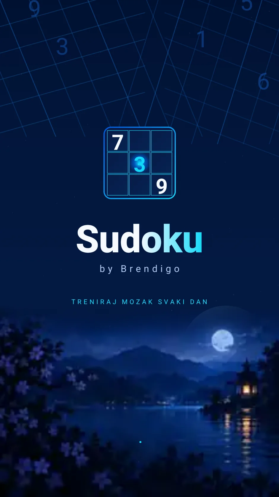</a></td>
</tr>
</table>

## ✨ Što Sudoku nudi

| Igra i način rada | Pojedinosti |
| --- | --- |
| Veličine ploče | **4×4, 6×6 i 9×9**, s provjerom jedinstvenog rješenja |
| Razina težine | **Vrlo lako, Lako, Srednje, Teško, Ekspert, Majstor** |
| Pomoć pri igranju | Bilješke, savjet, brisanje, poništavanje, isticanje brojeva |
| Osobni napredak | Povijest, najbolje vrijeme, rezultati i niz |
| Izazovi | Dnevna zagonetka vezana uz lokalni datum |
| Nagrade | 24 postignuća i bodovi |
| Pristupačnost | Opisi interaktivnih elemenata i prilagodljiv raspored |
| Povezivost | Potpuno offline, bez registracije |

> **Napomena o težini:** razine su trenutačno temeljene na količini uklonjenih
> početnih brojeva. Nisu zasebno ocijenjene naprednim solverom.

## ⬇️ Preuzimanje i instalacija

Najnoviji APK i Android App Bundle nalaze se na
**[GitHub Releases](https://github.com/bren-wp/Sudoku/releases)**.
Bez konfiguriranih izdavačkih ključeva, objavljeni APK je **testni APK**, a AAB
**nepotpisan**. Takvi artefakti nisu produkcijski potpisana Google Play izdanja.

**Android 8.0+** (API 26) · Paket `com.brendigo.sudoku` · Izdavač **Brendigo**.

## 🔐 Privatnost i sigurnost

Napredak i postavke spremaju se lokalno u privatnom prostoru aplikacije.
Nema korisničkog računa, oglasa, analitike ni mrežnih dozvola.
Detalji su u dokumentu [PRIVACY.md](PRIVACY.md). Napredak se ne sinkronizira
s internetom: deinstalacija ili kvar uređaja mogu ga trajno ukloniti.

---

**Sudoku by Brendigo** · *Bistriji um. Bolji dan.*

[Izdanja](https://github.com/bren-wp/Sudoku/releases) ·
[Prijava problema](https://github.com/bren-wp/Sudoku/issues) ·
[Licencija](LICENSE)

### Privatna sigurnosna kopija

Uz Sudoku 1.0.46 možete ručno izvesti napredak u šifriranu `.sudoku` datoteku. Prilikom izvoza lozinku potvrđujete dvaput, a prije povrata pregledavate broj partija u kopiji i na uređaju. Zamjena je moguća tek uz vašu izričitu potvrdu. Kopija se sprema tamo gdje sami odaberete u Androidovu pregledniku datoteka — aplikacija ne zahtijeva internetsku vezu niti račun. Zaštitite lozinku: nije moguće obnoviti zaboravljenu lozinku. Sve slike zaslona iznad stvarne su snimke emulatora, ne dizajnerski prikazi.

### Pixel QA (Splash 1/8)

Prva ciljano vizualna iteracija 1.0.41 usklađuje Splash logotip,
tipografiju, razmake i prikaz indikatora učitavanja s izvornom referencom.
Priložene slike zaslona su stvarni prikazi aplikacije; ažuriraju se tek
nakon uspješnog izvođenja Android emulator testa i provjere rezultata.
Postojeća referentna usporedba nije potvrda potpune pixel-perfect jednakosti.
Metodologija: [Splash pixel QA](docs/splash-qa-v1.0.41.md).

### Pixel QA — Početni zaslon (2/8)

Izdanje 1.0.42 usredotočeno je na stvarni Compose početni zaslon: naslov,
raspored, zadržavanje navigacije i ilustrirane kartice za nastavak, novu igru,
dnevni izazov, statistiku, postignuća i postavke. Korisnička statistika i
niz ne zamjenjuju se primjerima iz referentne slike. Vizualna usporedba
izvodi se na stvarnoj Android snimci, a točna 1:1 jednakost se ne tvrdi dok
razlike nisu izmjerene i uklonjene. Detalji: [Home pixel QA](docs/home-qa-v1.0.42.md).

### Zaslon 5/8 — Dnevni izazov

Za v1.0.45 prilagođeni su stvarni lokalni Compose elementi Dnevnog izazova: dnevni sažetak, velika kartica s izvornim pejzažom, tri informativne kartice, sedmodnevni niz i interaktivni gumbi. Dekorativna slika je izrezana **isključivo iz pozadine korisnikove izvorne reference** i ne sadrži nikakav UI tekst, datume ni gumbe; korisnički podaci i navigacija ostaju izvorni. Vizualni QA nalazi se u [dokumentaciji](docs/daily-qa-v1.0.45.md). Točna pixel-perfect 1:1 jednakost nije deklarirana bez nove usporedbe.
